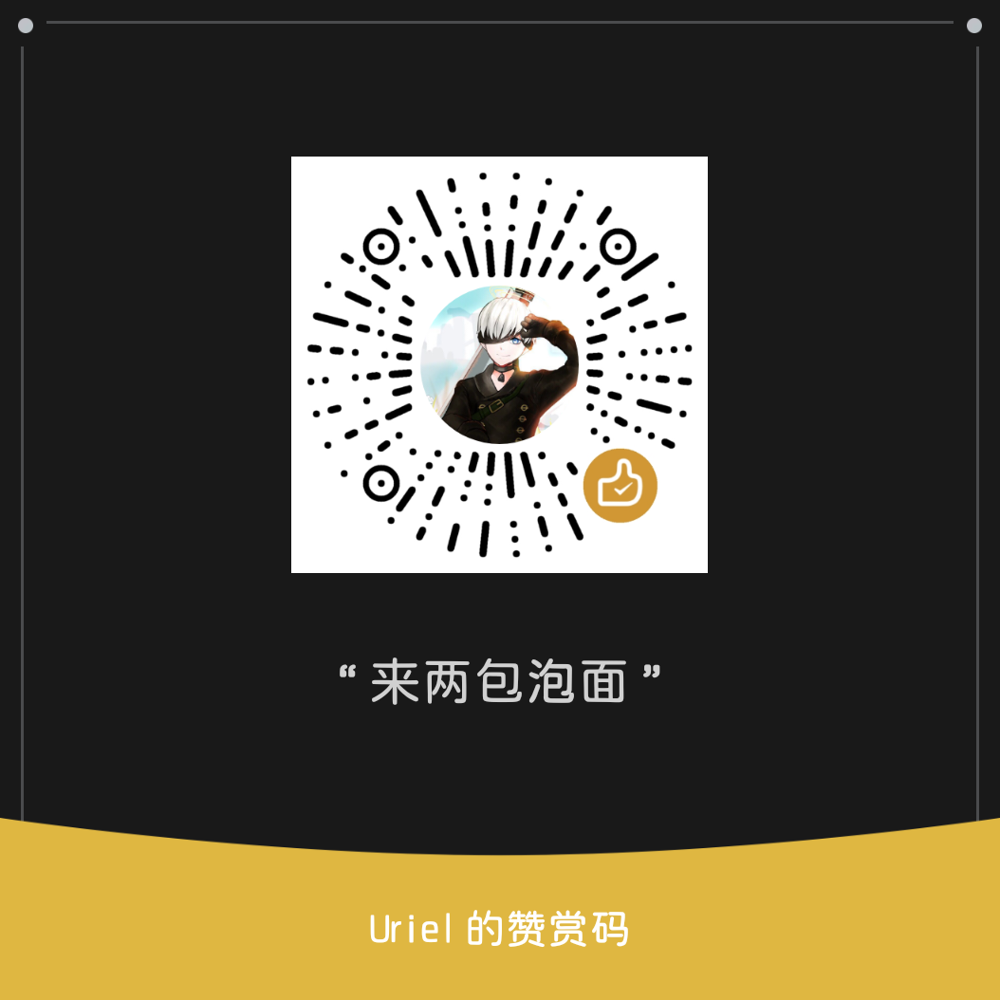

# 米哈游安卓账号切换工具

## 捐赠二维码

| 微信赞赏 | 支付宝 |
| --- | --- |
|  |  |

**本工具免费使用。** **捐赠完全自愿，不影响任何功能。** 如果这个工具帮到了你，欢迎打赏，感谢支持！

## 免责声明

> **本项目是个人独立开发和维护的原创工具。** **在法律允许的范围内，作者不对使用者自身侵犯游戏公司知识产权的行为承担责任；使用者应依法对其未经授权复制、分发游戏素材等侵权行为负责。** 本项目非米哈游或其他相关游戏公司的官方产品，与其无隶属、合作或授权关系。相关游戏名称、商标和素材的权利归各自权利人所有。本声明不排除作者依法应承担的责任，也不影响权利人依法主张权利。

在 **已取得 Root 权限的安卓手机** 上运行的米哈游账号切换 App：为同一款游戏保存多个账号状态，需要时一键切换并重新登录。

当前版本 **1.8.0**（应用名「米游账号切换」，正式签名 RSA-4096），支持：

- 崩坏：星穹铁道 4.7.0
- 原神 7.2.0
- 绝区零 3.3.0

> 三款游戏此前已完成真机双向切换验证（以游戏内 UID 对比确认）。1.7.0 真机验证了捐赠和关于页面，未重新验证游戏账号切换；本版改动及验证边界见[项目进度](docs/PROGRESS.md#发布与待发布状态)。

## 功能

- 每款游戏独立分栏，按账号去重，一个账号一张快照卡
- 拍摄快照不打断游戏；切号自动停止游戏 → 写入账号文件 → 校验 → 重新拉起
- 切换前自动保存安全快照，写入或校验报错时尝试回滚；历史版本也可从卡片菜单回滚
- 快照加密（Android Keystore AES-256-GCM）
- 卡片可编辑账号/密码备注（密码加密、默认打码、账号与密码可分别复制）
- 记住上次使用的分栏；悬浮「更新快照」按钮
- 「更多工具 → 主题」支持跟随系统、暗色模式和亮色模式
- 「更多工具」提供捐赠与关于页，捐赠完全自愿
- 正式签名包与 GitHub Release

## 发布与安装

GitHub Release 下载（已发布版本）：<https://github.com/STC214/HoyoSwitch/releases>

本地构建（需要 Python、JDK、ADB、Android SDK 36 / Build Tools 36.0.0）：

```powershell
python .\app\build.py             # 调试签名 -> dist\account-switch.apk
python .\app\build.py --release   # 正式签名 -> dist\account-switch-release.apk
```

- 正式密钥：`app/keystore/hoyoswitch-release.p12` 与 `keystore.txt`（已被 Git 忽略，需随项目保存）
- 正式证书 SHA-256：`81a5fc64529c23f1eef5a9de9cf32d6f6d71684aaf655c33f0adae36f59f9079`
- **同签名正式版升级不需要卸载**：包名和签名一致、版本号允许升级时，用 `adb install -r <APK路径>` 覆盖安装。调试版和正式版签名不同，不能互相覆盖安装。
- **卸载或清除应用数据会丢失密码备注及其本地密钥**，也会清除快照。换装前，请先在自己的密码管理器中确认相关账号仍有可用凭据。若旧密码已经读不出来，不要为排查问题而卸载或清除数据。

## 当前进度

- [x] 星铁：4 文件切换集，双向验证
- [x] 原神：3 文件切换集，双向验证（游戏内 UID 已脱敏，A/B 不同）
- [x] 绝区零：3 文件切换集，双向验证（游戏内 UID 已脱敏，A/B 不同）
- [x] 账号卡、账号密码、加密存储、历史回滚、悬浮按钮、分栏记忆
- [x] 正式签名、GitHub Release（1.0.0 → 1.7.4）
- ○ 最近删除回收站
- ○ 游戏大版本更新后的兼容性复核

备注：○（空心圆点）表示：有必要的时候再进行。

## 文档

- [详细需求文档](docs/需求文档.md)
- [App 说明与实现](docs/app/账号切换App原型.md)
- [项目进度与续接记录](docs/PROGRESS.md)
- 点位验证：[星铁](docs/research/星铁登录状态点位与验证记录.md) / [原神](docs/research/原神账号状态点位与验证记录.md) / [绝区零](docs/research/绝区零账号状态点位与验证记录.md)
- PC 验证工具：[账号状态快照](docs/tools/账号状态快照.md) / [登录状态开关](docs/tools/登录状态开关.md)
- 历史材料：[Android 原型](docs/prototype.md) / [星铁第一轮静态分析](docs/research/星铁账号切换调用链-20261119.md)
- [工作区规则](AGENTS.md)

## 目录约定

- `app/`：安卓 App 源码与构建脚本；`app/keystore/` 放正式密钥（Git 忽略）
- `dist/`：已验证的正式和调试 APK；构建中间文件使用 `app/build/` 下的临时目录并在结束时删除，只长期保留调试签名 `app/build/local-test.p12`（`dist/`、`app/build/` 均由 Git 忽略）
- `tools/`：PC 端验证脚本，不属于交付 App
- `prototype/`：早期流程原型（已被正式 App 取代，仅留记录）
- `docs/`：需求、进度、调研、工具文档
- `game-clients/`：游戏安装包（Git 忽略）
- `account-snapshots/`：本机敏感快照与备份（Git 忽略）

## 注意事项

- Root 操作涉及游戏本地数据，操作前请自行备份
- 快照只在会话有效期内可用；游戏内删除账号或清除数据会让旧快照失效
- 不要更换正式签名密钥，否则已安装版本无法覆盖升级。卸载换装会清除应用内保存的数据。
- 账号密码仅作备注，不参与切换逻辑
